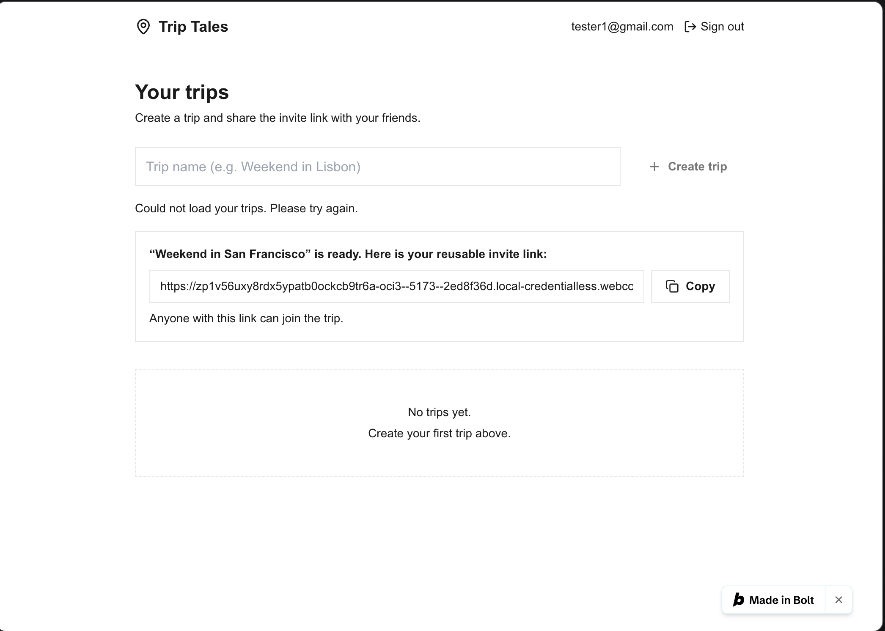
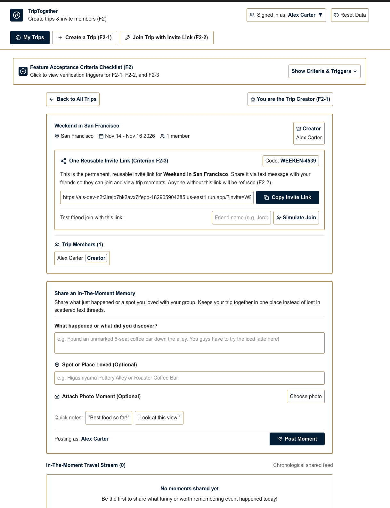

# HW6: Two Builders, One Specification

## Feature

**Team repository:** (https://github.com/mehtaaashi05/mgt3745-team-Alpha-)

**Spec provenance:** d8d60df297c3f0dfee3c06d737bcd880ebb95759 committed on 2026-10-08

**Feature:** F2 Create a trip and invite members (Must-be)

F2-1. WHEN a signed-in person creates a trip with a name, the app shall make them its creator and give them an invite link.

F2-2. IF someone tries to join a trip without a valid invite link, THEN the app shall refuse and show no trip details.

F2-3. The app shall give each trip one reusable invite link. (probe)

## See It Work

| bolt.new | AI Studio |
|---|---|
|  |  |

## Status

| Row | bolt.new | AI Studio |
|---|---|---|
| F2-1 | Partial | Pass |
| F2-2 | Pass | Pass |
| F2-3 | Fail | Pass |

Top error: bolt.new's database policy for trip_members recurses forever (Postgres
42P17), so no joined member can open the trip. 

## How to Run the Evals

`npm test` runs `node --test "evals/**/*.test.js"`. The same four tests run against
both builds. The AI Studio adapter unzips `builds/aistudio.zip` and runs its
`storage.ts`. The bolt.new adapter calls its live Supabase project using the
anon key in `scratch/bolt/project/.env` (unzip `builds/bolt.zip` into
`scratch/bolt` first). It creates throwaway accounts and trips there. Without those
settings the bolt.new tests are skipped. 

These were the results: 

✔ AI Studio F2-1: creator assigned and invite link given (5.56ms)
✔ AI Studio F2-2: invalid link refused, no trip details (0.68ms)
✔ AI Studio F2-3: one link, accepted from two different people (0.50ms)
✔ AI Studio F2-3: a member who joined can then see the trip (0.53ms)
✔ bolt.new F2-1: creator assigned and invite link given (1509.02ms)
✔ bolt.new F2-2: invalid link refused, no trip details (328.66ms)
✔ bolt.new F2-3: one link, accepted from two different people (378.70ms)
✖ bolt.new F2-3: a member who joined can then see the trip (235.90ms)
ℹ tests 8 | pass 7 | fail 1
{ code: '42P17', message: 'infinite recursion detected in policy for relation "trip_members"' }

Run date: October 17, 2026

## Links

- [EVALS.md](EVALS.md): Prediction Stake and error log
- [COMPARISON.md](COMPARISON.md): evidence, spec gaps, and recommendation
- [JUDGMENT.md](JUDGMENT.md): judgment eval and agreement rate
- [prompts/PROMPT.md](prompts/PROMPT.md): the exact input both builders received
- [builds/](builds/): bolt.zip and aistudio.zip
- [docs/DDR-001.md](docs/DDR-001.md) (bolt.new), [docs/DDR-002.md](docs/DDR-002.md) (AI Studio)
- Team pull request or issue: [Issue #59](https://github.com/mehtaaashi05/mgt3745-team-Alpha-/issues/59)

## Hours

6 hours

## AI Use

Bolt.new [DDR-001](./docs/DDR-001.md) and Google AI Studio [DDR-002](./docs/DDR-002.md) were used for this assignment. I ran every test, made every verdict from my own screenshots, and used a separate person as the second grader.
